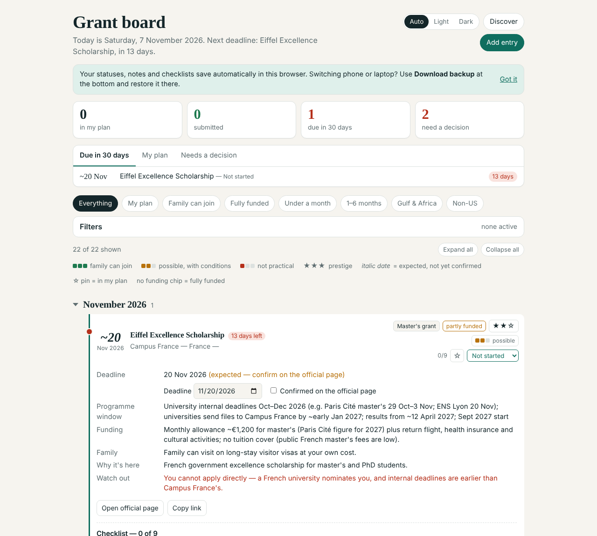
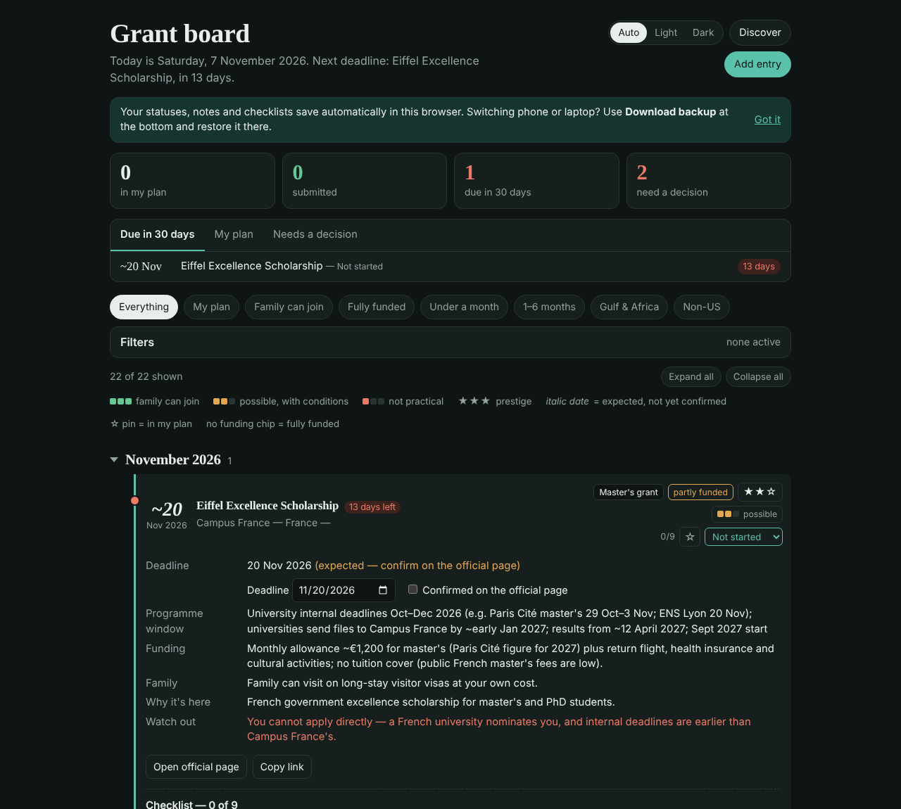
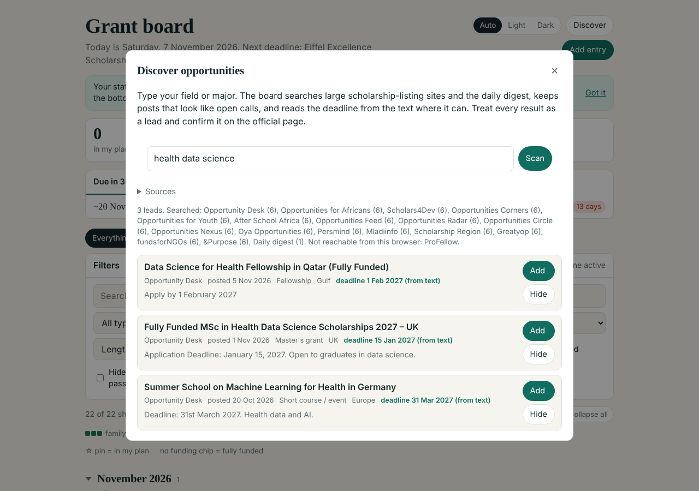

<p align="center"></p>

<h1 align="center">Grant board</h1>

<p align="center">A single-file, offline tracker for scholarships, fellowships and short programmes —<br>ordered by deadline, filterable, with progress tracking, calendar export and a built-in opportunity finder.</p>

<p align="center"> </p>

## Why

Funding calls are scattered across dozens of sites, deadlines move every cycle, and the useful details — does it cover tuition, can your family come, is the date confirmed or just last year's — get lost in browser tabs. Grant board keeps one curated list in one HTML file that opens anywhere, works without a server, and never sends your data anywhere.

## Features

- **Timeline by deadline** — entries grouped by month, with urgency colours, days left, and *expected* vs *confirmed* dates.
- **Filters and quick views** — type (degree, 1–6 month fellowship, short course/event, rolling route), region, funding level, length, prestige, family-friendliness, status, non-US.
- **Progress tracking** — status per entry, notes, per-type checklists, pin to "my plan", deadline overrides with a "confirmed on the official page" tick.
- **Focus panel** — *due in 30 days*, *my plan*, and *needs a decision* (passed deadlines still open).
- **Discover** — type your field (e.g. `health data science, machine learning`) and the board searches the public WordPress search API of 18 large opportunity-listing sites straight from the browser, plus a daily digest. It keeps posts that look like real calls, reads the deadline from the text, guesses type/region/funding, de-duplicates cross-posts, and adds a lead to the board in one click (flagged as unverified).
- **Calendar export** — `.ics` with all-day deadline events and 30/14/3-day reminders.
- **Your data stays yours** — auto-save to `localStorage`, JSON backup/restore, CSV export, and "load updated dates" that merges a refreshed dataset without losing progress.
- **Light/dark themes**, keyboard shortcut (`/` to search), print stylesheet, mobile layout.
- **No build tooling, no dependencies, no tracking.** Vanilla HTML/CSS/JS.

<p align="center"><br><sub>Discover panel (illustrative results)</sub></p>

## Try it

Open `index.html` in any modern browser, or use the GitHub Pages demo if enabled. The bundled dataset in `data/sample-data.json` is a sample of real programmes captured in November 2026 — dates change every cycle, so always confirm on the official page.

### Run it like a desktop app (Windows)

Chromium browsers can open a page in its own window. Create a shortcut with:

```
"C:\Program Files (x86)\Microsoft\Edge\Application\msedge.exe" --app="file:///C:/path/to/index.html"
```

Put it in `shell:startup` to launch at login, and use `docs/icon.ico` as the shortcut icon.

## Use your own list

```bash
python build.py --data my-data.json --out my-board.html --title "My grant board"
```

Each entry looks like:

```json
{
  "id": "sisgp", "name": "Swedish Institute Scholarships for Global Professionals",
  "org": "Swedish Institute", "type": "degree", "region": "Europe", "country": "Sweden",
  "deadline": "2027-01-15", "approx": false, "closed": false,
  "window": "University application by 15 Jan; scholarship form in February",
  "duration": "1–2 years", "prestige": 2, "family": 3,
  "family_note": "Spouse can get a residence permit with work rights.",
  "us": false, "funding": "Tuition + monthly stipend + travel grant",
  "fit": "Why it is on the list", "caveat": "What to watch out for",
  "url": "https://si.se/…", "verified": true, "dbucket": "long", "fund": "full"
}
```

`type`: `degree | fellowship | short | route` · `region`: `UK | Europe | Gulf | Africa | Asia | Americas | Global` · `prestige`, `family`: 1–3 · `fund`: `full | partial | paid` · `dbucket` (length): `short | mid | long` · optional `checklist: []` overrides the default checklist.

## How Discover works

| Part | Where | What it does |
|---|---|---|
| Live search | browser (`src/template.html`) | Calls `/wp-json/wp/v2/posts?search=…` on each enabled source in parallel with a timeout; sources that block cross-origin requests are reported, not fatal. |
| Daily digest | `scanner/scan.py` + `.github/workflows/scan.yml` | GitHub Action (stdlib Python) runs daily, collects broad queries from the same sources, keeps 120 days of posts and commits `data/discovered.json`. The board reads it from `raw.githubusercontent.com`. |
| Parsing | browser | Strips HTML, filters for call-like titles, scores by your terms (title hits weigh more), extracts deadlines near "deadline / apply by / closes", guesses type, region and funding, and sorts open calls first. |

Results are leads, not facts: everything imported is marked unverified until you confirm it.

## Project layout

```
index.html               built board with sample data (open this)
src/template.html        the app — markup, styles and script in one file
data/sample-data.json    sample dataset
data/discovered.json     daily digest written by the Action
build.py                 splices a dataset into the template
scanner/                 digest scanner and its source list
docs/                    screenshots and icon
```

## Privacy

Nothing leaves your browser except the Discover search requests to the listed public sites. Progress lives in `localStorage` on your device; back it up with **Download backup**.

## License

MIT
